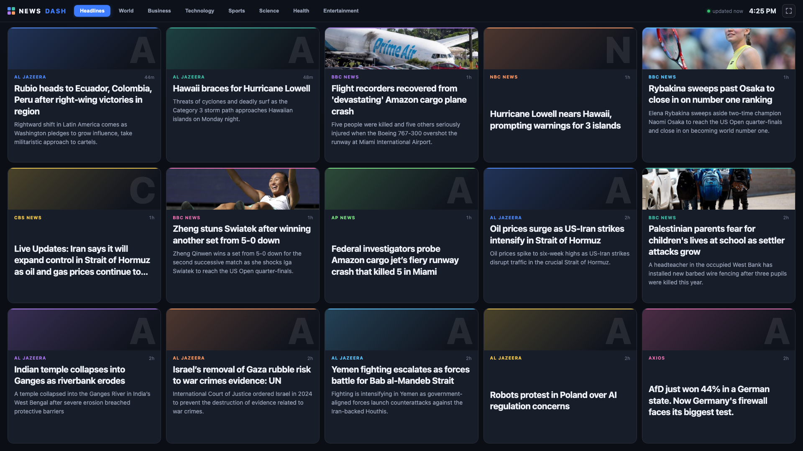

# News Dashboard

[](https://github.com/AntonyPerez0/news-dashboard/actions/workflows/ci.yml)
[](https://github.com/AntonyPerez0/news-dashboard/actions/workflows/deploy.yml)
[](https://www.typescriptlang.org/)
[](https://react.dev/)
[](#testing)

A live news dashboard built for a second monitor. Ten categories of headlines
cycle continuously through a grid of rich tiles — photos, excerpts, source
logos — so the news stays glanceable without ever touching a scrollbar.

**Live:** [newsdash.page](https://newsdash.page/)



## Why this project exists

The interesting engineering problem here isn't displaying news — it's keeping
a browser tab healthy and populated for weeks of unattended runtime, fed by
inconsistent third-party data, with zero API keys and zero server costs.

## Highlights

- **React 18 + strict TypeScript** — the whole frontend is typed end-to-end,
  including the data layer that transparently switches between a live Express
  API and pre-built static snapshots
- **Heartbeat tile engine** — every tile's swap is a timestamp comparison on a
  single 250 ms heartbeat, so swaps, hover-pauses, countdown bars and
  stuck-state healing are pure functions of time; a throttled background tab
  can never permanently stall one
- **Photo & excerpt pipeline** — most RSS feeds ship no image or summary, so
  each story falls back to scraping the article's `og:image` /
  `og:description` / JSON-LD metadata — after resolving Google News gateway
  links back to real publisher URLs. Coverage: ~90 % photos, ~90 % excerpts;
  scraper-blocking publishers (WSJ, Reuters) degrade to styled monograms
- **Self-healing data layer** — `Promise.allSettled` per feed means one dead
  outlet never takes down a category; fuzzy near-duplicate collapsing stops
  lightly-reworded versions of the same story appearing twice; SWR caching
  with negative-result backoff keeps upstream feeds unharmed during outages
- **10 categories, 20+ feeds** — Headlines, World, Business, Technology,
  Sports, CS Esports, Gaming, Science, Health, Entertainment, aggregated from
  BBC, NPR, Al Jazeera, The Verge, Ars Technica, ESPN, HLTV, Polygon, IGN,
  GameSpot, Eurogamer and more
- **Quality gates** — Vitest tests over the data pipeline, the tile engine
  and the polling hook, plus a strict `tsc` typecheck, all wired into CI on
  every push

## Testing

The test suite targets the parts where real data bites: Google News title
suffix stripping (doubled suffixes, hyphenated outlets like `WSB-TV`),
XML sanitizing of unescaped `&`, betting-spam filtering, meta-tag extraction
with fallback chains, grid layout math across aspect ratios, and deduping.
Component tests (jsdom) cover the unattended-runtime cases: a photo that
fails to load, a refresh arriving mid-cycle, and data that has gone stale.

```bash
npm test        # no network required
```

CI runs typecheck + tests + production build on every push; the deploy
workflow rebuilds and republishes the site with fresh data on a schedule
(see [Live-site freshness](#live-site-freshness)).

## Architecture

```
GitHub Action (scheduled)                   local: npm start
       │ scripts/generate-data.js                  │ /api/news (10-min SWR cache)
       ▼                                           ▼
dist/data/<category>.json  ─── both served to ───┐
                                                 ▼
                      browser polls every 5 min (live API first,
                      transparent static-snapshot fallback)
```

```
src/                          server/
  components/                   server.js      Express, SWR cache, API
    Tile.tsx        tile engine   news.js      RSS fetch, dedupe, meta scrape
    TileGrid.tsx    grid + heartbeat          feeds.js    feed registry
    Header.tsx      nav, clock, status      scripts/
    SettingsDrawer  speed, density            generate-data.js  static build
  hooks/        useNews, useClock, useWindowSize
  api.ts        live-API-first data layer
  types.ts      shared contracts
```

**Design decisions worth calling out:**

- **Timestamp-driven UI** — the vanilla predecessor used per-tile
  `setTimeout` chains, which froze whenever a timer died. The React rewrite
  stores each tile's `nextSwapAt` and compares it against a heartbeat, making
  every visual state recoverable and testable
- **API-first, static-fallback** — the same frontend runs from `npm start`
  (freshest data) and GitHub Pages (pre-built snapshots), chosen at request
  time by whether the API responds
- **Enrichment in the background** — headlines respond in seconds; photo
  scraping continues server-side and the client picks up enriched data on a
  quick follow-up poll, so cold starts never block

## Live-site freshness

The deploy workflow is scheduled for every 15 minutes, but GitHub runs
scheduled workflows on a best-effort basis. In practice the hosted site is
refreshed a few times a day, 3 to 10 hours apart; when its data is older than
45 minutes the header says so ("stale · updated 4h"). For continuously fresh
headlines run the dashboard locally with `npm start`, which fetches the feeds
itself.

GitHub also disables scheduled workflows after 60 days without repository
activity. Any commit resets the clock; if the schedule has been switched off,
turn it back on with `gh workflow enable deploy.yml` or from the Actions tab.

## Run it

```bash
npm install
npm run build     # strict typecheck + vite build
npm start         # → http://localhost:3000 (API + built app)
```

Developing:

```bash
npm run dev           # vite dev server (proxies API to :3000)
npm run dev:server    # Express with hot reload
npm run test:watch    # vitest watch mode
```

Keyboard: `F` fullscreen · `Space` pause/resume · `1`–`9`, `0` categories ·
`Enter` open focused story

## Adding feeds

Registry lives in [`server/feeds.js`](server/feeds.js):

```js
gaming: {
  label: 'Gaming',
  feeds: [
    { url: 'https://www.polygon.com/rss/index.xml', name: 'Polygon' },
    // aggregate: true strips the " - Outlet" suffix Google News appends
    { url: 'https://news.google.com/rss/…', name: 'Google News', aggregate: true }
  ]
}
```

## Versioning & changelog

Releases follow [semver](https://semver.org/) and are tagged; notable changes
are documented in [CHANGELOG.md](CHANGELOG.md). Contributions welcome — see
[CONTRIBUTING.md](CONTRIBUTING.md).

## License

MIT — see [LICENSE](LICENSE).
